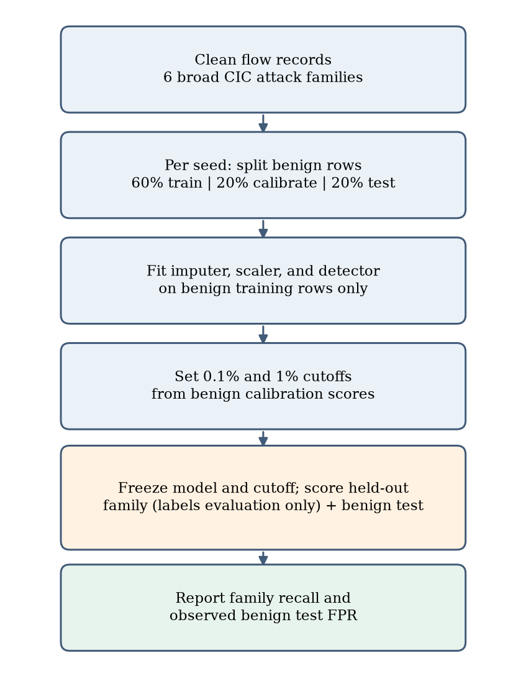
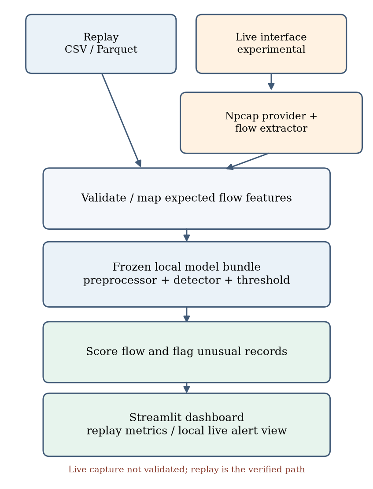
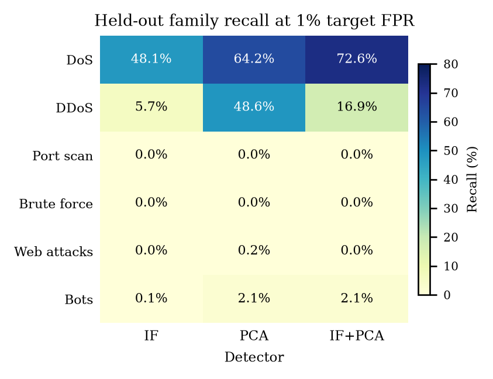

# Evaluating Flow-Based Network Anomaly Detectors on Held-Out Attack Families and Across Datasets

Sakshi Singh, Rushil Chaudhary, Zoya Parveen, and Yashsvi Sharma
Department of Computer Science and Engineering (Artificial Intelligence), Galgotias College of Engineering and Technology, Greater Noida, India

<!-- The course, instructor, submission venue, and any required AI assistance statement are intentionally left for the team to complete if required. -->
<!-- IEEE TWO COLUMN START -->

**Abstract:** Network intrusion detectors are commonly evaluated on attack categories represented during model fitting, which does not establish performance on an unseen category. We compare benign only anomaly detectors using leave one attack family out (LOFO) evaluation on a cleaned and preprocessed CICIDS2017 derivative. At 0.1% and 1% benign calibration false positive rate (FPR) targets, equal weight Isolation Forest and principal component analysis (PCA) rank fusion had the highest macro family recall at 0.1% (7.4%), while PCA reconstruction had the highest recall at 1% (19.2%); worst family recall was zero or nearly zero. A supervised known attack classifier with an unknown rejection score achieved 15.1% macro recall at 1%, but was evaluated with capped per class training samples. In cross dataset transfer, CIC calibrated FPR reached 7.56% on the UNSW NB15 test partition at a 1% target. In the reverse direction, PCA recall on CIC reached 67.0% with a 39.6% benign FPR. These results show that ranking gains can come with prohibitive alert drift. We also implement offline replay and an experimental live flow scoring path. A synthetic packet capture verified feature column mapping and scoring for one flow; real interface capture remains unvalidated because a packet capture provider is unavailable on the Windows machine. Held out families are a zero day style proxy, not real zero day evidence.

**Index Terms:** network intrusion detection, anomaly detection, CICIDS2017, held out attack families, false positive rate, score fusion, cross dataset evaluation.

## I. INTRODUCTION

Machine learning based network intrusion detection must generalize beyond familiar attack examples while keeping benign alerts at a usable rate. A detector can obtain high attack recall by flagging nearly everything, so recall must be interpreted alongside the false positive rate (FPR) and the alert budget [1].

This study asks whether benign only anomaly detectors can identify an attack family excluded from fitting and threshold selection. A real future zero day cannot be observed in a retrospective dataset. We therefore use leave one attack family out evaluation as a limited novelty proxy: a known labeled family is hidden from the detector and used only after the model and threshold are frozen. This does not establish detection of an actual unknown exploit or arbitrary future behavior.

We compare Isolation Forest (IF), PCA reconstruction error, and an equal weight rank fusion of their scores. We also add a sampled supervised classifier that learns benign and known attack families and scores low confidence as potential unknown behavior. The work contributes an auditable LOFO pipeline, family level fixed budget results, transfer experiments in both CICIDS2017/UNSW NB15 directions, a comparison of benign only and supervised strategies, and an offline replay dashboard with an experimental live flow scoring path. The contribution is an empirical comparison and reproducible implementation, not a new detection algorithm.

The research questions are: **RQ1:** Which tested strategy has the highest recall on held out families at fixed FPR budgets? **RQ2:** Does score fusion improve worst family recall? **RQ3:** How do recall and benign FPR change across two benchmark datasets and transfer directions? **RQ4:** How does a benign only detector compare with a classifier trained on known attacks and equipped with an unknown rejection score?

## II. RELATED WORK

Isolation Forest uses random recursive partitions to isolate unusual observations [2]. PCA based network anomaly detection uses residual error or subspace deviation; its sensitivity to feature and aggregation choices has been studied in traffic analysis [3]. Autoencoders learn nonlinear reconstruction patterns from benign data and have been used in online network anomaly detection, including the Kitsune ensemble [4]. Shone et al. combine stacked non symmetric deep autoencoders with a Random Forest classifier and evaluate on KDD Cup '99 and NSL KDD [8]. Their supervised classification results motivate representation learning but are not directly comparable with our benign only family holdout protocol.

Security machine learning requires care with data leakage, label quality, and evaluation design [1]. Random row splits may place near duplicate or same family examples in both partitions; family holdout asks a more demanding question but remains dependent on the dataset's labels and testbed. Cross dataset studies also require attention to feature construction and changes in benign distributions. We explicitly report target domain FPR rather than assuming the calibration budget transfers.

## III. DATASETS AND PREPARATION

### A. CICIDS2017 derivative

The primary input is the team supplied **CICIDS2017: Cleaned & Preprocessed** Kaggle derivative by Eric Anacleto Ribeiro [5]. Its publisher describes merging CICIDS2017 CSVs, removing duplicates and selected features, handling missing or infinite values, and grouping labels. We did not independently reproduce the publisher's complete cleaning pipeline or legally audit its license declaration. This is not confirmed as the corrected LycoS release. The source has 2,520,751 rows, 52 numeric flow features and an `Attack Type` label.

Our preparation normalized label strings, removed 161 exact duplicate rows, and quarantined 1,394 rows in 697 groups with feature identical but conflicting labels. The retained data contain 2,519,196 rows. Table II reports retained labels. These broad aggregates limit family conclusions; no fine grained attack type claims are made.

**TABLE I**

**DATASET PARTITIONS AND FEATURE USE**

| Dataset and role | Rows | Benign / normal | Attack families | Features used |
|---|---:|---:|---:|---|
| CIC Kaggle derivative, primary | 2,519,196 | 2,094,199 | 6 aggregate families | 52 selected numeric |
| UNSW NB15 training partition | 175,341 | 56,000 | 9 categories | 9 mapped features |
| UNSW NB15 fixed test partition | 82,332 | 37,000 | 9 categories | 9 mapped features |

**TABLE II**

**RETAINED CIC AGGREGATE LABEL COUNTS**

| Label | Rows | Label | Rows |
|---|---:|---|---:|
| Benign | 2,094,199 | DoS | 193,615 |
| DDoS | 128,011 | Port scanning | 90,130 |
| Brute force | 9,150 | Web attacks | 2,143 |
| Bots | 1,948 | Total | 2,519,196 |

### C. Common feature mapping for transfer

Table III summarizes the nine approximate CIC/UNSW measurements. CIC `Flow Duration` is microseconds and is divided by 1,000,000. CIC backward packet count is derived as `Bwd Packets/s * Flow Duration / 1,000,000`. UNSW flow byte rate is derived as `(sbytes + dbytes) / dur`; zero duration becomes missing and is imputed from source training data. These are semantic correspondences, not assertions that Argus/Bro and CICFlowMeter compute identical features.

**TABLE III**

**NINE APPROXIMATELY ALIGNED TRANSFER FEATURES**

| Measurement | CIC-derived feature | UNSW feature |
|---|---|---|
| Duration, seconds | Flow Duration / 1,000,000 | dur |
| Source packet count | Total Fwd Packets | spkts |
| Source bytes | Total Length of Fwd Packets | sbytes |
| Source mean packet bytes | Fwd Packet Length Mean | smean |
| Destination mean packet bytes | Bwd Packet Length Mean | dmean |
| Total bytes per second | Flow Bytes/s | (sbytes + dbytes) / dur |
| Destination packet count | Bwd Packets/s * Flow Duration / 1,000,000 | dpkts |
| Source initial TCP window | Init_Win_bytes_forward | swin |
| Destination initial TCP window | Init_Win_bytes_backward | dwin |

### B. UNSW NB15

UNSW NB15 was created using the UNSW Canberra Cyber Range Lab and Argus/Bro flow generation [9]. We use public mirrors of the documented fixed training and test partitions because the official download was unavailable in the project environment. Row counts, labels, and feature layout were checked against the published partition profile; SHA 256 hashes pin our mirror files but cannot authenticate them against provider checksums, which are not published. Data files are not committed to the repository.

## IV. METHODOLOGY

### A. Leakage controlled LOFO protocol

For each seed (17, 29, 43), benign CIC rows are split into approximately 60% training, 20% calibration, and 20% benign test partitions. Numeric imputation and standardization are fit on training data only. Labels, family labels, timestamps, flow identifiers, and endpoint addresses are excluded from features. Each benign only detector is fit on benign training data. For each LOFO fold, one complete attack family is absent from fitting and threshold calibration; test evaluation combines that family with the disjoint benign test set. A separate benign calibration score distribution selects cutoffs for 0.1% and 1% target FPR. All settings and weights are frozen before scoring held out families. Fig. 1 summarizes the separation.

### B. Compared strategies

**Isolation Forest:** 150 tree estimators with automatic maximum subsample size; larger transformed scores indicate greater unusualness [2]. **PCA reconstruction:** PCA retains 95% of explained variance and scores the row wise mean squared reconstruction error [3]. **Rank fusion:** IF and PCA scores are converted to empirical percentiles using benign calibration scores and averaged with equal weights. We do not interpret anomaly scores as probabilities.

**Exploratory autoencoder:** A feed forward autoencoder with hidden width 32, bottleneck width 8, 30 epochs, batch size 512, and Adam learning rate 0.001 is implemented. Its LOFO comparison is capped at 50,000 rows per family because full data CPU training was impractical; it is not in the full data model ranking.

**Supervised known attack plus rejection reference:** A HistGradientBoosting classifier is trained on benign rows and capped samples of all known attack families except the held out family. Its score is the larger of the estimated non benign mass and one minus the maximum class confidence. A cutoff is still set from benign calibration data only. This uses labels for known attack families during fitting and is therefore distinct from the benign only detectors. The exploratory run uses three seeds, up to 1,000 rows per training class, and 15 boosting iterations.

### C. Metrics and statistical analysis

We report per family recall, macro family recall, worst family recall, observed benign test FPR, area under the receiver operating characteristic curve (AUROC), area under the precision-recall curve (AUPR), mean fit time, and score latency. Macro recall averages family recalls equally. FPR is false alerts divided by benign records; alert rate is alerts divided by all records and is not FPR. Threshold target and measured test FPR can differ. AUPR depends on class prevalence; balanced replay is for demonstration only.

The main IF/PCA/fusion comparison averages seeds within each held out family before the Friedman test and grouped bootstrap confidence intervals. Nemenyi post hoc comparisons and critical difference diagrams are saved with generated analysis. There are only six family blocks, and they reuse benign partitions, so inferential results are exploratory. For the four strategy comparison, the same family blocks are used, but the supervised model is sampled and not fully tuned.

### D. Cross dataset transfer

The CIC to UNSW experiment fits and calibrates on CIC benign training/calibration rows and freezes its thresholds for the UNSW test partition. The reverse experiment fits and calibrates using benign rows from the UNSW training partition and evaluates on CIC and the UNSW test partition. Both directions use the nine mappings in Table III. Argus/Bro and CICFlowMeter measurements are only approximate semantic matches. Target labels are evaluation only.

### E. System implementation

The Python pipeline prepares flow records, fits local model bundles, evaluates datasets, and stores results and protocol metadata. The Streamlit dashboard supports uploaded CSV/Parquet replay, model comparison, alert metrics when labels are present, and monitoring a local live scored flow file. The experimental live path connects a network interface to a pinned CICFlowMeter compatible Python extractor, maps completed flows to the bundle's features, scores them, and records minimized flow summaries for the dashboard. It omits raw packets and endpoint IP addresses. Scores arrive when a flow ends or times out, so long lived flows can be delayed.

The extractor produced the required feature columns and the model scored one synthetic PCAP flow. This checks code compatibility for that example, not numerical equivalence to the training extractor or real network detector quality. On the Windows development machine, interface names are listed but Scapy reports no libpcap provider; Npcap/live capture has not been validated. The system does not block traffic. Capture must be restricted to authorized networks and local flow summaries should be protected.

## V. RESULTS

### A. Full data CIC LOFO comparison

Table IV shows the full data IF/PCA/fusion results. At 0.1%, fusion led macro recall at 7.4%; at 1%, PCA led at 19.2%. Worst family recall was zero in five of the six detector/budget pairs, and only 0.0022% for PCA at 1%. Fig. 3 shows that most detected attacks were DoS or DDoS; web attacks, port scans, and brute force were largely missed.

**TABLE IV**

**FULL DATA CIC LOFO RESULTS (PERCENT EXCEPT AUROC/AUPR)**

| Target FPR | Detector | Macro recall [95% CI] | Worst family | Test benign FPR | AUROC / AUPR |
|---:|---|---:|---:|---:|---:|
| 0.1% | IF | 0.0 [0.0, 0.0] | 0.000% | 0.091% | 0.7189 / 0.2767 |
| 0.1% | PCA | 5.3 [0.1, 12.2] | 0.000% | 0.096% | 0.7881 / 0.3498 |
| 0.1% | IF + PCA | 7.4 [0.1, 20.0] | 0.000% | 0.098% | 0.7845 / 0.3285 |
| 1.0% | IF | 9.0 [0.0, 25.0] | 0.000% | 1.011% | 0.7189 / 0.2767 |
| 1.0% | PCA | 19.2 [0.4, 40.6] | 0.0022% | 0.989% | 0.7881 / 0.3498 |
| 1.0% | IF + PCA | 15.3 [0.3, 39.1] | 0.000% | 0.997% | 0.7845 / 0.3285 |

The Friedman tests did not reach the 0.05 significance level (p=0.097 at 0.1%; p=0.094 at 1%), and no Nemenyi pairwise result was significant. This is not evidence that the models are equivalent. Mean training times were 1.67 s for IF, 5.53 s for PCA, and 7.13 s for fusion on the project machine. Mean per row scoring latency was 0.0083, 0.0009, and 0.0091 ms, respectively. These values are implementation and hardware specific.

### B. Autoencoder and supervised reference

On the separate capped autoencoder sample, macro recall was 3.4% at 0.1% and 21.5% at 1%, with worst family recall 0% and 0.03%. This is exploratory and not a like for like full data ranking.

**TABLE V**

**SAMPLED SUPERVISED LOFO REFERENCE**

| Target FPR | Macro recall | Worst family after seed averaging | Mean benign test FPR |
|---:|---:|---:|---:|
| 0.1% | 3.52% | 0.00% | 0.094% |
| 1.0% | 15.12% | 0.28% | 1.002% |

At 1%, supervised recall was highest on held out DDoS (62.3%) and lowest on web attacks (0.28%). At 0.1%, recall was low across families. Four model Friedman tests including IF, PCA, fusion, and the sampled supervised reference yielded p=0.158 at 0.1% and p=0.054 at 1%; neither was significant at 0.05. The capped training set and only six family blocks constrain interpretation.

### C. Cross dataset results in both directions

Tables VI and VII report the target domain results for each transfer direction. At a 1% CIC calibration budget, the forward CIC to UNSW transfer produced 5.90%-7.56% benign FPR on UNSW. In the reverse direction, PCA's 67.0% recall at the 0.1% budget coincided with 39.61% benign FPR on CIC; at the 1% budget the FPR was 43.61%. The apparent recall increase is a severe alert cost, not an operating point improvement. Dataset shift and approximate feature alignment prevent a general cross network claim.

**TABLE VI**

**CIC TO UNSW TRANSFER (TARGET DOMAIN: UNSW TEST PARTITION)**

| CIC target | Model | CIC recall | UNSW recall | UNSW benign FPR |
|---:|---|---:|---:|---:|
| 0.1% | IF | 0.10% | 0.28% | 0.197% |
| 0.1% | PCA | 0.64% | 1.31% | 1.185% |
| 0.1% | IF + PCA | 0.72% | 0.78% | 0.992% |
| 1.0% | IF | 1.06% | 2.10% | 5.903% |
| 1.0% | PCA | 1.32% | 3.35% | 6.331% |
| 1.0% | IF + PCA | 1.06% | 3.04% | 7.560% |

**TABLE VII**

**UNSW TO CIC TRANSFER (TARGET DOMAIN: CIC DERIVATIVE)**

| UNSW target | Model | UNSW recall | CIC recall | CIC benign FPR |
|---:|---|---:|---:|---:|
| 0.1% | IF | 0.37% | 0.08% | 0.158% |
| 0.1% | PCA | 0.69% | 66.98% | 39.606% |
| 0.1% | IF + PCA | 0.57% | 0.62% | 0.545% |
| 1.0% | IF | 0.94% | 0.68% | 0.410% |
| 1.0% | PCA | 2.90% | 72.87% | 43.610% |
| 1.0% | IF + PCA | 2.74% | 6.50% | 11.392% |

### D. Replay and live scoring status

The dashboard replay sample contains 1,000 records from each of six attack categories and 1,000 benign records. At its fixed bundle thresholds, the observed attack recall/benign FPR were 9.1%/0.2% for IF, 19.6%/1.7% for PCA, 15.9%/0.2% for fusion, and 22.3%/1.3% for the autoencoder. This balanced sample is a user interface demonstration, not a natural prevalence estimate or the LOFO result.

**TABLE VIII**

**SYSTEM VALIDATION STATUS**

| Component | Status | Evidence and limitation |
|---|---|---|
| Offline flow replay | Implemented | Scores CSV/Parquet with expected features |
| Dashboard comparison | Implemented | Local bundles; labels show replay metrics |
| Flow feature mapping | Smoke checked | One synthetic PCAP scored; feature values not validated |
| Live interface capture | Not validated | Npcap provider absent on Windows |
| Blocking response | Not implemented | Alerts only; no blocking |

## VI. DISCUSSION

No method dominates all families and budgets. Fusion led at the stricter 0.1% target, while PCA led at 1%, but the family blind spots and small block count prevent a general winner claim. The supervised known attack strategy attained higher 1% macro recall than the benign only core models in this sampled setting, but it still missed or nearly missed some families and is not a fully tuned comparison. Its use of labeled known attacks is a different operating assumption.

The cross dataset results emphasize threshold portability: a model can rank target attacks highly while raising many false alarms on target benign traffic. In particular, PCA's reverse transfer recall is unusable without recalibration because of its very high CIC benign FPR. Recalibrating on target benign data may improve operations but is not unsupervised zero day evaluation on the original frozen threshold.

The deployed prototype is a local review tool. Offline replay is functional; live capture code is experimental and currently not validated on a real interface. Dashboard alert rate is not FPR when ground truth labels are absent. An alert is an anomaly flag, not proof of compromise, and the system does not block traffic.

## VII. LIMITATIONS AND ETHICAL CONSIDERATIONS

The CIC input is a Kaggle prepared derivative whose complete preprocessing and license were not independently audited. Its labels collapse multiple attack types into six broad families. The UNSW mirror hashes pin project inputs but are not provider checksums. The two datasets are public testbed benchmarks, and their feature tools differ. The nine feature mapping is approximate.

Family holdout tests generalization to a withheld known label category, not an actual future zero day. The primary comparison has six family blocks with reused benign partitions; repeated seeds do not equal independent networks. The autoencoder is sampled, and the supervised reference uses 1,000 rows per class and 15 iterations. Full tuning and full data runs were not completed. Live capture has only synthetic feature mapping evidence, no real network benign alert measurement, and no independent flow extractor comparison.

Any capture must be performed only on a network the team owns or has explicit permission to monitor. Flow metadata can reveal private activity even when raw packets and endpoint IPs are omitted. Store local captures and summaries securely, clear them after the demonstration, and use replay as the fallback. The prototype is not a production security control.

## VIII. CONCLUSION

This paper evaluates benign only anomaly detection on held out CICIDS2017 attack families, adds a sampled supervised known attack plus rejection reference, and measures cross dataset transfer in both directions. Under the tested protocol, fusion led at the 0.1% target and PCA led at 1%, but worst family recall remained near zero. Transfer exposed substantial alert drift, including a 39.6%-43.6% CIC benign FPR for reverse transfer PCA. These findings support reporting family level recall with observed FPR and caution against treating a benchmark flag as zero day proof. The local dashboard supports replay and anomaly review. A live scoring path is implemented but awaits Npcap enabled validation on an authorized interface. Conclusions apply only to these models, datasets, feature mappings, and settings.

## DATA AND CODE AVAILABILITY

Project code, protocol, and instructions are at https://github.com/git-sakshii/ZeroDayAttack. Dataset files, fitted model bundles, and generated result CSVs are local and excluded from the public repository. The evaluated inputs and checksums are documented in `DATASETS.md` and the local run JSON files. Numeric table entries were transcribed from the saved CSV summaries and per-family metrics under `results/`; the included figure script regenerates the family recall plot. The paper includes no claim of independent real network validation.

## REFERENCES

[1] D. Arp, E. Quiring, F. Pendlebury, A. Warnecke, F. Pierazzi, C. Wressnegger, L. Cavallaro, and K. Rieck, “Dos and Don'ts of Machine Learning in Computer Security,” in *Proc. 31st USENIX Security Symp.*, 2022, pp. 3971-3988. [Online]. Available: https://www.usenix.org/conference/usenixsecurity22/presentation/arp

[2] F. T. Liu, K. M. Ting, and Z.-H. Zhou, “Isolation Forest,” in *Proc. 8th IEEE Int. Conf. on Data Mining (ICDM)*, 2008, pp. 413-422, doi: 10.1109/ICDM.2008.17.

[3] H. Ringberg, A. Soule, J. Rexford, and C. Diot, “Sensitivity of PCA for traffic anomaly detection,” *ACM SIGMETRICS Performance Evaluation Review*, vol. 35, no. 1, pp. 109-120, 2007, doi: 10.1145/1269899.1254895.

[4] Y. Mirsky, T. Doitshman, Y. Elovici, and A. Shabtai, “Kitsune: An Ensemble of Autoencoders for Online Network Intrusion Detection,” in *Proc. Network and Distributed System Security Symp. (NDSS)*, 2018, doi: 10.14722/ndss.2018.23204.

[5] E. A. Ribeiro, “CICIDS2017: Cleaned & Preprocessed,” Kaggle dataset, version 6, Jan. 12, 2025. [Online]. Available: https://www.kaggle.com/datasets/ericanacletoribe/cicids2017-cleaned-and-preprocessed. [Accessed: Nov. 24, 2026].

[6] I. Sharafaldin, A. H. Lashkari, and A. A. Ghorbani, “Toward Generating a New Intrusion Detection Dataset and Intrusion Traffic Characterization,” in *Proc. 4th Int. Conf. on Information Systems Security and Privacy (ICISSP)*, 2018, pp. 108-116, doi: 10.5220/0006639801080116.

[7] E. A. Ribeiro, “CICIDS2017 - Comprehensive Data Processing for ML,” Kaggle notebook, and “ML Intrusion Detection CICIDS2017,” GitHub repository. [Online]. Available: https://www.kaggle.com/code/ericanacletoribeiro/cicids2017-comprehensive-data-processing-for-ml and https://github.com/anacletu/ml-intrusion-detection-cicids2017. [Accessed: Nov. 24, 2026].

[8] N. Shone, T. N. Ngoc, V. D. Phai, and Q. Shi, “A deep learning approach to network intrusion detection,” *IEEE Transactions on Emerging Topics in Computational Intelligence*, vol. 2, no. 1, pp. 41-53, Feb. 2018, doi: 10.1109/TETCI.2017.2772792.

[9] N. Moustafa and J. Slay, “UNSW-NB15: a comprehensive data set for network intrusion detection systems,” in *Proc. Military Communications and Information Systems Conf. (MilCIS)*, 2015, doi: 10.1109/MilCIS.2015.7348942. [Online]. Available: https://research.unsw.edu.au/projects/unsw-nb15-dataset.

[10] pycicflowmeter contributors, “CICFlowMeter-compatible flow feature extraction,” GitHub repository, commit 4432a32. [Online]. Available: https://github.com/Shahid-Wani/pycicflowmeter. [Accessed: Nov. 24, 2026].
